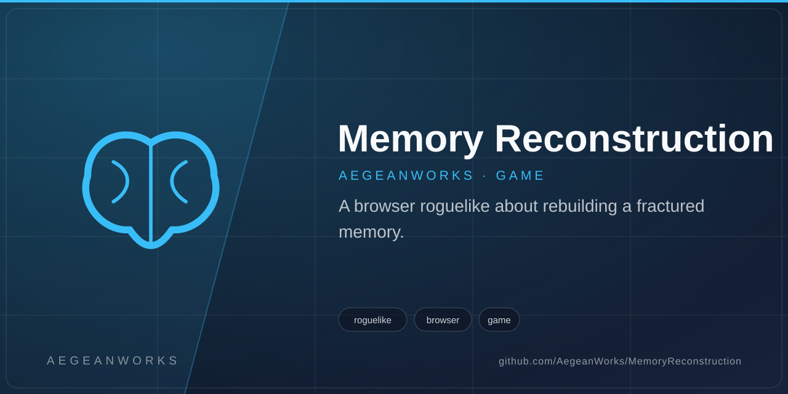

# Memory Reconstruction

<!-- aegean:media:start -->
<p align="center"></p>
<p align="center"><a href="LICENSE"></a> <a href="https://github.com/AegeanWorks/AIKit"></a></p>
<!-- aegean:media:end -->


**A top-down action roguelike about rebuilding a shattered world from lost memories.**


## ⚡ 30-Second Cold-Start Quick Reference

- **Runtime Prerequisites**: Node.js >= 18, npm >= 9
- **Canonical Regression Shield Gate**:
  ```bash
  npm test
  ```

### 🛠️ AIKit Commands (run from the AIKit folder)

| Role                              | Command                                       |
| --------------------------------- | --------------------------------------------- |
| Status, task and gates            | `python aikit.py status MemoryReconstruction` |
| Phase 4: every gate               | `python aikit.py check MemoryReconstruction`  |
| Repair memory and map, then check | `python aikit.py fix MemoryReconstruction`    |
| Resume an interrupted task        | `python aikit.py resume MemoryReconstruction` |

## 📦 What's Inside

```text
MemoryReconstruction/
├── .aikit/                   <- this project's memory: record, ledger, decisions
├── .github/
├── .gitattributes            <- LF normalization and binary asset rules
├── .gitignore                <- transient AIKit state excluded
├── .prettierrc
├── PROJECT_PRINCIPLES.md
├── README.md
├── COMMERCIAL.md
├── assets/
├── docs/
├── eslint.config.js
├── index.html
├── LICENSE
├── LICENSES/                 <- REUSE license texts
├── REUSE.toml                <- Machine-readable SPDX metadata
├── ASSETS.md                 <- Asset/data manifest: what the license covers
├── package-lock.json
├── package.json
├── scripts/
├── src/
├── start.bat
├── start.sh
├── tests/
├── tsconfig.json
├── tsconfig.node.json
└── vite.config.ts
```

## Overview

You are a **Memory Walker** setting out from the **Sanctuary** on expeditions through twenty-seven procedurally generated sections, from the Forgotten Ruins to the Sanctuary of Reconstruction and the first name beneath it. Each section is a set of rooms: walk into one and its doors seal until every enemy is gone. Grow stronger by picking upgrades and wearing relics, beat each section's guardian, and step through the rift it leaves behind. Defeat the First Memory on the twenty-fifth section to win.

Death ends the expedition, but **memory fragments** you recover are kept forever, and half the shards still in hand are banked as **echoes** at the Sanctuary. Spend echoes to rebuild the Sanctuary — each restored structure is a permanent starting bonus, so the place visibly grows back as you recover its story. Every third section becomes a **checkpoint**: after falling, retry from the last checkpoint or start again from the beginning.

Gather all of a memory's fragments to restore it and read its story in the _Memories_ panel.

### Features

- **Readable combat**: every enemy attack has a red ground telegraph (arc, line, circle or aim line) before it lands; enemies never deal contact damage.
- **A crueller deep**: enemy damage grows additively by 5% for every section past the first (section 2 is 1.05x, section 3 is 1.10x) and by another 5% for every room you clear, so twenty cleared rooms add up to double damage and the section steps stack on top. Each later wave of a room brings one more enemy and another 10% damage. Levels come much slower: the XP curve is 42 × 1.6 per level (levels cost 42, 67, 108, 172, 275...) and kills pay only 30% of their listed XP, so upgrades are earned rather than showered.
- **Three-hit combo** with weapon-specific slash signatures (spear piercing lance with vortex lines, greatsword seismic arc and finisher ground shockwave, sword glowing blade spine); a dash with fading phantom afterimages and two charges; a mana-powered bolt with directional comet wake; hit-stop, starburst crits, screen shake, sparks and damage numbers.
- **Flow streaks and grazes**: kills inside a 3 s window build a Flow streak worth up to +50% XP and shards, and taking a hit drops it; dashing past or through the edge of an attack is a _graze_ that refunds mana, part of a dash charge and flow-window time.
- **Variable-ratio loot surges**: shard drops sometimes roll a rich vein (2.5x, ~18%) or a memory surge (5x, ~6%), each with its own sound and banner. All engagement numbers live in `src/sim/tuning.ts` and are covered by `tests/sim/engagement.test.ts`.
- **Optional floor objective**: clear every combat room and open the chest before the guardian falls for a shard-and-potion _floor restored_ bonus; a room cleared without taking damage also pays a _flawless_ bonus. Progress is shown in the HUD and on the map, with a tick on cleared rooms (cyan while secrets remain, gold when mastered) and a pulse on unclaimed chests and wells.
- **A Sanctuary hub and five living rooms**: the hub is a clean UI screen - a facade card for each resident, the restoration ledger and progress bar, the Training Yard, Meditation Stone and Notice Board, and the expedition actions. Every resident (Archivist, Smith, Gardener, Warden, Lamplighter) has a clickable **Enter** that puts you inside their own furnished room: sealed walls, their own floor plan (the Archive's bookstack stubs, the Forge's furnace bay, the Garden's rounded corners, the Barracks' drill columns, the Lamp House's crypt niches, the Hearth's alcove), their own floor and wall material, their own furniture set (shelves, tomes and a lectern; anvil, weapon racks and bellows; planters, vines and seed trays; shields, drill gear and a training dummy; lamps, candles and a lamp ladder; tables and a pantry), the resident, who works a short route between their own furniture (the Smith goes from anvil to hearth to armory) and stops to face you when you come to talk, and a door back to the hub. Rooms are real walkable worlds, not menus, and each reads as a different place.
- **NPC quests and requests**: every resident offers three chapters of tasks derived from your save (fragments, lifetime kills, elites, restored structures, depth, guardians, vault relics or trust), and each claimed chapter earns a closing line of story when you next speak to them. Every quest also carries a **bonus tier** 20% past its target that pays 40% extra echoes. Claiming pays echoes and some rewards become permanent relics in your starting kit. Each resident also asks for one specific relic from your vault: the hub card shows **Wants (relic name)**, turns to **Give (relic name)** once the vault holds it, and to **Relic given** after the hand-over, which pays echoes and a heart of trust; the same request sits on their page beside **Offer tribute** and an **Ask about the road** hint. All six resident descriptions fit on their hub cards whole, with no ellipsis.
- **Twenty-seven sections, four echo trials and checkpoints**: four boss-only **Echo Trial** episodes sit between normal sections: one huge arena each with a unique guardian (the Choir Hierophant, the Hollow Behemoth, the Mirror of Self and the Abyssal Revenant), no trash, 1.5x health and rich relic rewards. **The Gilded Reliquary** and **The Salt Orchard** extend the late road with reliquary constructs and orchard-grown horrors before the Keeper, and **The Chitin Vault** and **The Thunder Vault** carry the hive and the storm past them, so the descent runs two sections deeper than the Sanctuary. Sections 1, 4, 7, 10, 13, 16, 19, 22, 25 and 27 unlock as start points; skipping ahead grants vestige upgrades and a matching starting level.
- **Eight map layouts and four room shapes**: branching mazes, rings, spines, grids, diamonds, crosses, four-lobed clovers and switchback terraces, plus rectangles, rounded halls, octagon arenas and cave-bitten rooms. Combat rooms pick from seven interior patterns (open, pillars, scatter, alcoves, a **colonnade** of two columned rows around a clear aisle, a **chicane** of offset walls that force an S-shaped route, and a broken ring). **Arena** rooms hold a solo echo guardian mid-floor; **library** rooms trade a fight for lore and shelves. About two thirds of large combat rooms carry an **iron portcullis** on an otherwise blank perimeter wall: waves can step in through it, the player cannot cross it, the gate pulses crimson while the room still owes waves, and the minimap marks it with a crimson hatch.
- **Sixteen biomes, one hundred and five enemies, twenty-seven bosses, including four unique Trial guardians**: melee bruisers, skirmishers that circle and lunge, **duellists that swing three-hit combos, dash in and fire thin bolts exactly like the player**, casters that kite and cast new **fans**, rotating **sweeps**, bolt **walls** with a dodge gap, and marching **pillar** eruptions, bombers that lob fused bombs, brutes that slam, and bosses with unique silhouettes and three health phases. Late-game enemies (ash heralds, frost oracles, bloom sentinels, grave wardens, void heralds, bone pickers, lantern wraiths, cinder stalkers, spire marksmen and more) join the rosters with signature attacks: prism lancers fire a lane of light, quake colossi stomp a radial shock, brine chargers throw you across the room, mire wardens drag every step short inside their aura, and bog spitters foul the floor with slowing mud; Obsidian Reavers turn a room-wide sweep, First Echoes answer with a bolt wall, Hive Oracles read the comb's future into a wall of stinging light, and Ossuary Chanters leave a gap in their burial hymn for the living to stand in. Boss patterns include sweeping beams, mortar barrages, proximity mines, bullet spirals, blink strikes, bomb rain, hook pulls and quake lines; the Reliquary Warden counts relics behind a beam-and-slam rotation, the Salt Orchard Hydra summons and spits through flowering heads, late sections field deep wave chains up to ten waves, sometimes with the wave total hidden for suspense, and summon their own roster, and the Hive Queen and Bone Tyrant add two new silhouettes (queen and tyrant). The Mirror trial ends one road; the last road ends beneath the Keeper's lantern at **The First Remembering**, where the first name waits in a boss with a six-pattern rotation. Every guardian also shows a one-line field-guide entry under its boss bar, drawn from its bestiary description.
- **Relics**: weapons, armor, trinkets, headwear and capes drop from bosses, elites, chests and maze merchants. Five worn slots, a twenty-slot carried bag (**I**) shown as a grid of relic icons (one drawn per relic by `scripts/generate_relic_icons.py`) beside a paper doll of your wanderer (pick a relic with a click or Enter to see its stats and what it changes against your worn relic, with Equip, Sell and Discard beside it; double-click or drag it onto its slot or the wanderer to wear it, drag a worn relic back to the bag to take it off; arrow keys move between the boxes). Worn armor re-colours the wanderer's robe in the game and on the doll in the colours of its own icon (never the hood, which stays the wanderer's own), a worn cape re-colours their cloak in its own palette, a worn head piece draws its own silhouette above the head (hood, helm, circlet or visor) in its own colours (a separate cyan band, so robe and cape colours never fight), and a worn trinket circles them as a coloured glow with stat mods that stack with upgrades, and auto-equip on the first empty slot. Some relics are **weapon-locked**: they only count while the matching stance is held (Echo Dagger wants the sword, Duelist Mantle and Storm Dial want the spear, Void Cleaver and Colossus Plate want the greatsword), so the bag shows "Needs the spear stance" and refuses the equip until you switch. Four three-piece **relic sets** (Ashforged, Tidebound, Voidwrought, Reliquary) grant a two-piece and a three-piece bonus, shown as chips on the bag and on each piece's sheet. The bag sells carried relics for shards and, once full, sells new relic pickups for shards on the spot. Vault relics beyond the worn slots and bag stay home; the **Set Out** screen sells spares for echoes and shows which relics will travel. Reaching a section entrance is a checkpoint: the relics you carry are banked in the Sanctuary, and only relics found after that checkpoint are lost if you fall (a victor brings home everything). The bag (**I**) spells this out: a checkpoint-bank line says how many relics are kept and how many new finds are at risk until the next entrance.
- **Three stances**: switch mid-run with **1 / 2 / 3** between the balanced Sword, the long narrow Spear (bonus at max reach, stays mobile) and the slow wide Greatsword (its finisher always shockwaves). Each has its own reach, arc, timing, held weapon model and attack animation; **V** fires a stance art on a 7s cooldown (sword nova, spear pierce, greatsword quake).
- **Bombs and traps**: throw bombs (**G**) that bounce, fuse, chain-detonate and hurt both sides, or place a trap (**T**) that arms and ignores allegiance. Bombardier and Hive Drone enemies throw their own bombs.
- **Sanctuary amenities**: the hub's Places column opens the Training Yard for your starting stance, the Meditation Stone for a one-expedition boon (it shows your echoes and how many more a boon needs), and the Notice Board for the quest section. Three further places carry long-term decisions: **The Reliquary** attunes one relic from your vault to be equipped first every expedition, and **The Cairn** banks up to three echo offerings, each carrying 45 starting shards into the next run. **The Aspect Shrine** sets a permanent playstyle mark - Unmarked, Ember (melee), Tide (magic) or Stone (defence) - applied to every expedition. **The Reforge** reinforces a vault relic up to three ranks for +12% per rank on all its numeric mods, carried into every run. The hub is capped at exactly eight places.
- **Quest Log and Notice Board**: an RPG-style journal reachable from the pause menu, the Notice Board and directly in a run with **J** (touch: Quests), with an active/ready/completed/available count, filter tabs, a giver portrait for every task, chapter labels, a main progress bar with exact numbers, a second **bonus** bar with its echo reward, reward lines, a **Track** button that pins the chosen task under the HUD floor line while it is open, the daily mark, and a **weekly contract** of forty elite kills for 800 echoes that resets with the ISO week and is the same for everyone. The Sanctuary **Notice Board** is a real board of pinned notes: accept a resident's next chapter, track it, or visit the giver without walking the hub. Completion is still turned in by talking to the resident.
- **Passive dangers and a living room**: spike plates, flame vents, poison pools and rockfall telegraph before they fire; barrels explode when struck, crates and urns spill shards and draughts, memory crystals sear nearby echoes and crack neighbouring breakables, and a blast lights nearby props so clusters cook off in a chain. Levers disarm a room's traps without touching its loot, and fountains heal once. Player traps add a tactical layer, and every trap hurts enemies as well.
- **In-run travel and secrets**: the entrance holds a **Wayfarer** (one generous upgrade choice) and a **waystone** (fast travel between the entrance and the deepest visited room, once per floor); a shrine or treasure room can hold a paid **Ferryman** who crosses the walker straight to the floor's guardian; a **wandering merchant** is guaranteed on every floor (a treasure room may add a second behind its sealed cache) and opens a stall selling red and blue flasks, bombs, traps and one relic for shards, with each line selling once per stall (the red line reads **Flasks full** while the rack is full); a dead-end chamber can be a **sealed vault**, hidden behind wall until a lever elsewhere opens it; late rooms can break into a three-enemy **memory storm**.
- **Surprises**: chests can be mimics, a merchant's stall sells flasks, bombs, traps and a relic for shards, barrels and crates hide loot, some rooms spring a second elite ambush, some memories detonate when broken, libraries hide archives, and echo trials interrupt the normal run.
- **Elemental pressure**: flame hazards set enemies and the walker burning for steady damage, poison pools drag them into mud that slows movement, and a frozen target takes a shatter bonus until the ice breaks with the next hit. Bolt shots test against the drawn sprite, not only its small body circle, so a hit that looks like a hit lands. Rime Chanters sing freezing verses, and frozen floors lay ice that holds your steps for a moment.
- **Music**: every biome has an ambient and a battle track, plus a shared guardian theme, all listed in `src/data/music.json` and shipped as 33 short loops in `assets/music/`, rendered by `python scripts/synthesize_music.py` with no keys and no dependencies (`--verify` checks them). `python scripts/generate_music.py` can render a studio-quality Muse batch instead when provider keys exist, and those files take precedence. The game loops whatever it finds with a crossfade, switching to the battle track when a room seals and back to ambient when it clears. A track whose file is missing falls back to the built-in procedural music, which is itself calm and battle variants, and the menu and Sanctuary deliberately keep the calm piece.
- **Rage stances**: **X** cycles calm → **Frenzy** → **Berserker** → calm. Frenzy deals the most damage (x1.6) and the screen edges turn red, but any blow that lands breaks it; Berserker deals x1.35 behind an ember-orange edge and cannot be interrupted, so it is the steady long fight.
- **QoL**: weapon/consumable HUD, quest log from pause or **J**, and misclick-safe upgrade picks (a level-up card ignores the swing click that opened it, ignores double-clicks, and needs a deliberate click or a `1/2/3` key after a short grace), a two-press **Abandon Run**, reroll an offer for shards (key **R** on the choice screen only), a pause summary with the run's records and owned echoes, a HUD that clears completely behind menus, a readable boss bar with a live health percentage, and a room map that fills the panel with a legend for the player, explored rooms, treasure, wells, guardians, libraries and arenas. Relic rarity is written out in words as well as colour-coded, and a relic row with three actions stays inside a phone-width panel instead of clipping.
- **27 upgrades** offered as cards on level-up (common, rare and epic), from treasure chests and from Memory Wells that trade shards for healing and a pick. Forty memory fragments and twelve core memories carry the lore, including the Foundry, the Mire, the Gilded Reliquary, the Salt Orchard, the Hive, the Catacombs, the Sunken Tideways, the Howling Spire and the First Remembering. The Memories tab counts what is recovered and tells you which biome still hides each sealed fragment.
- **Bestiary**: the Memories codex has a second tab recording every enemy and guardian you defeat. All 105 species are listed, guardians are tagged, and a discovered entry reveals its field-guide line and its lifetime defeat count; unknown entries stay sealed. A filter bar switches between **All**, **Recorded**, **Sealed** and **Guardians**, so the rest of the codex is one click away. Open any card (click, **Enter** or **Space**) to see the sections it appears in as "Section 3 (Forgotten Ruins)", with the guardian's own section marked; a recorded species also shows its health, damage and XP, while a sealed one keeps only the road that hides it. First kills record automatically and announce themselves, and recording every species pays 1000 echoes once.
- **Top-down 2.5D look**: procedurally painted biome tiles with lit wall faces, masonry mortar joints and ambient occlusion, depth-sorted sprites, animated boss phase runic floor auras and elite crowns, glows, soft flickering torchlight on the walls, a per-biome colour grade, gentle tonal patches across the floors, dynamic darkness vignette around the player, and a layered ambient field per biome (dust, spores, embers, ash, snow, petals, bubbles, fireflies or drifting void).
- **Synthesized audio**: every sound and the ambient score are generated with the Web Audio API.
- **Accessibility**: Settings can turn off screen shake, the hurt flash and damage numbers. A player who asked their OS to reduce motion gets the shake and flash off on a fresh save, and every decorative loop (title sheen, breathing buttons, pulsing badges) stops while toasts, memory cards and floor banners still fade on time instead of sliding. Every menu is exposed as a named modal dialog, so a screen reader announces "Settings" or "Paused" rather than an unnamed region.
- **Save slots**: three slots, chosen from **Saves** on the title screen. Each keeps its own progress and expedition; settings are shared by all three. A slot can be exported to a `.json` file and imported back (a file that is not a save, is from a newer version or is damaged is refused with the reason, and importing over progress asks first); deleting takes a second click. A corner note confirms each save and warns when the browser refuses one. A save from before slots moves into slot 1 on its own.
- **Saves**: the expedition is saved at each section's entrance and can be continued from the Sanctuary gate (_Continue_); echoes, restoration levels, the checkpoint, lifetime kills, quest state, the relic vault and recovered memories persist in the browser.
- **Keyboard and mouse, gamepad or touch.** On a touch screen two on-screen sticks (left moves, right aims and attacks), buttons for dash, bolt, flask, use, stance, the weapon art, the rage stance, bombs and traps, and a relic bag, quest log, mana flask, map and menu button appear automatically, so no keyboard is needed. The whole touch layer and the HUD keep clear of notches and home bars.

### Why these mechanics

The engagement pass is grounded in the same behavioral-game-design literature that shapes CyberPulse's design notes:

| Principle                                             | Source             | In Memory Reconstruction                                                                |
| ----------------------------------------------------- | ------------------ | --------------------------------------------------------------------------------------- |
| Variable-ratio reinforcement, reward prediction error | Skinner; Schultz   | Rich vein and memory surge loot rolls per kill                                          |
| Near-miss striatal response                           | Clark et al., 2009 | Graze rewards for slipping past an attack instead of only avoiding it                   |
| Loss aversion / prospect theory                       | Kahneman & Tversky | Flow streak is a stake you can lose: any hit resets it                                  |
| Flow channel                                          | Csikszentmihalyi   | Streak multiplier tightens the 3 s window: risk rises with reward                       |
| Zeigarnik effect                                      | Zeigarnik          | Visible floor objective (rooms + chest) and unclaimed markers on the map                |
| Competence & autonomy (PENS)                          | Ryan & Deci        | Flawless-room bonus, rerollable offers, mastery recorded on the pause and death screens |
| Goal gradient                                         | Kivetz et al.      | Objective line counts down as the floor nears completion                                |

All odds stated here match `src/sim/tuning.ts` and are verified by seeded tests. Ethics line: tension yes, manipulation no — no pay-to-win, no infinite sunk-cost loops, no fake near-misses (every graze/clutch/surge is a real roll), no countdown coercion. Push-your-luck caches state their blood price up front and walking away is always free.

## Quick Start

```bash
# Zero-friction launcher
start.bat          # on Windows
./start.sh         # on Linux/macOS

# Or via npm
npm install
npm start          # opens the dev server on http://localhost:3000

npm test           # unit and simulation tests
npm run test:mechanics  # headless simulation gate (tests/sim)
npm run build      # production build in dist/
```

## Controls

| Action            | Keyboard / mouse | Gamepad     |
| ----------------- | ---------------- | ----------- |
| Move              | WASD / arrows    | Left stick  |
| Aim               | Mouse            | Right stick |
| Strike (hold)     | Left click / J   | RT          |
| Memory bolt       | Right click / K  | LT          |
| Dash              | Space / Shift    | A / RB      |
| Potion            | Q                | X           |
| Mana flask        | R                | -           |
| Quest log         | J                | -           |
| Interact          | E / F            | Y           |
| Switch weapon     | 1 / 2 / 3        | D-pad       |
| Relics & supplies | I                | -           |
| Bomb / trap       | G / T            | L3 / R3     |
| Weapon art        | V                | LB          |
| Rage stance       | X                | -           |
| Map               | Tab / M          | Back        |
| Pause             | Esc / P          | Start       |
| Pick a card       | Click / 1 / 2 / 3 | B          |
| Reroll cards      | R (choice only)  | -           |
| Menus             | Tab + Enter/Space| -           |

## How It Is Built

The game is split so the rules never depend on the screen:

```text
src/
  sim/      deterministic game rules: dungeon generation, physics, player,
            enemies, combat, upgrades, run state, Sanctuary hub; no DOM, no PixiJS
  view/     PixiJS renderer: procedural tile art, sprites, telegraphs, effects, camera
  ui/       DOM overlay: HUD, minimap, menus and upgrade cards (ui.css)
  input/    keyboard, mouse, gamepad and touch, turned into one input frame per step
  audio/    Web Audio synthesis for effects and ambience
  save/     localStorage persistence, validated with zod
  app/      the state machine (title, hub, play, pause, choice, map, death, victory)
  data/     enemies, biomes, lore and sprite atlas JSON
```

The simulation advances in fixed 1/60 s steps from a seed, so a run with the same seed and inputs replays exactly. Tests drive a `World` headlessly. In the browser, `window.__MR__` exposes the running app for automated playtests.

- [Architecture](docs/ARCHITECTURE.md): modules, data flow and the frame loop
- [Commit-Range Audit](docs/COMMIT_RANGE_AUDIT.md): cumulative verification of the project history
- [State Machines](docs/STATE_MACHINES.md): implicit transitions, their guards and deferred proposals
- [Visual UI Review](docs/UI_REVIEW.md): responsive layout and combat-readability captures
- [AI Agent Guide](docs/AI_AGENT_GUIDE.md): how to add enemies, upgrades, bosses and biomes
- [Graphics](docs/Graphics.md): art direction and the asset pipeline
- [Contributing](docs/CONTRIBUTING.md): workflow and checks

## Tech Stack

TypeScript (strict), PixiJS 8, Vite, Vitest, zod and the Web Audio API.

## Development

```bash
npm run dev         # dev server with hot reload
npm test            # all tests
npm run lint        # ESLint + Prettier
npm run typecheck   # tsc --noEmit
npm run build       # typecheck + production bundle

# Regenerate sprites and the sprite atlas (Python + Pillow)
python scripts/generate_art_assets.py
```

`.github/workflows/ci.yml` runs install, lint, typecheck, tests and the build on every push and pull request.

## Credits

- **Roguelike design**: inspired by Hades, Enter the Gungeon, The Binding of Isaac and Dead Cells
- **Art style**: inspired by Hyper Light Drifter

<!-- aegean:brand-assets:start -->
## 🎨 Brand Assets

> **AI-Generated Brand Artwork.** The banner and logo are **AI-generated brand assets**. They are illustrative and may not literally depict every feature or the full project scope.
<!-- aegean:brand-assets:end -->

## 📜 License

Free for personal play under the Aegean Game License 1.1 (AGL-1.1); see [LICENSE](LICENSE). It is DRM-free: Licensor ships no DRM and a distributor may not add it. Streaming, modding and free mods are allowed. Commercial use, paid mods and AI training need the Aegean Commercial License 1.0 (ACL-1.0); see [COMMERCIAL.md](COMMERCIAL.md).
