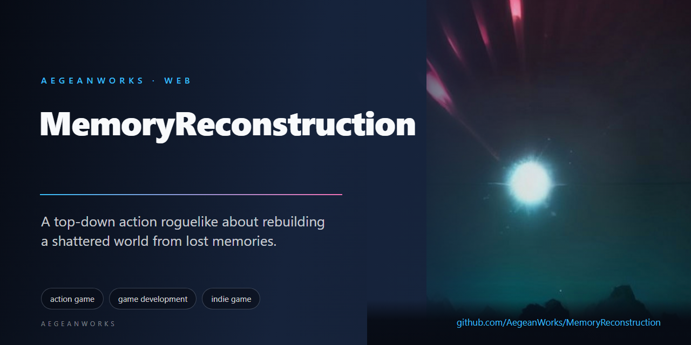

# Memory Reconstruction

<!-- aegean:media:start -->
<p align="center"></p>
<p align="center"><a href="LICENSE"></a> <a href="https://github.com/AegeanWorks/AIKit"></a></p>
<!-- aegean:media:end -->


**A top-down action roguelike about rebuilding a shattered world from lost memories.**


## ⚡ 30-Second Cold-Start Quick Reference

- **Runtime Prerequisites**: Node.js >= 18, npm >= 9
- **Canonical Regression Shield Gate**:
  ```bash
  npm test
  ```

### 🛠️ AIKit Commands (run from the AIKit folder)

| Role                              | Command                                       |
| --------------------------------- | --------------------------------------------- |
| Status, task and gates            | `python aikit.py status MemoryReconstruction` |
| Phase 4: every gate               | `python aikit.py check MemoryReconstruction`  |
| Repair memory and map, then check | `python aikit.py fix MemoryReconstruction`    |
| Resume an interrupted task        | `python aikit.py resume MemoryReconstruction` |

## 📦 What's Inside

```text
MemoryReconstruction/
├── .aikit/                   <- this project's memory: record, ledger, decisions
├── .github/
├── .gitattributes            <- LF normalization and binary asset rules
├── .gitignore                <- transient AIKit state excluded
├── .prettierrc
├── PROJECT_PRINCIPLES.md
├── README.md
├── COMMERCIAL.md
├── assets/
├── docs/
├── eslint.config.js
├── index.html
├── LICENSE
├── LICENSES/                 <- REUSE license texts
├── REUSE.toml                <- Machine-readable SPDX metadata
├── ASSETS.md                 <- Asset/data manifest: what the license covers
├── package-lock.json
├── package.json
├── scripts/
├── src/
├── start.bat
├── start.sh
├── tests/
├── tsconfig.json
├── tsconfig.node.json
└── vite.config.ts
```

## Overview

You are a **Memory Walker** setting out from the **Sanctuary** on expeditions through sixteen procedurally generated sections, from the Forgotten Ruins to the Sanctuary of Reconstruction. Each section is a set of rooms: walk into one and its doors seal until every enemy is gone. Grow stronger by picking upgrades and wearing relics, beat each section's guardian, and step through the rift it leaves behind. Defeat the Keeper on the sixteenth section to win.

Death ends the expedition, but **memory fragments** you recover are kept forever, and half the shards still in hand are banked as **echoes** at the Sanctuary. Spend echoes to rebuild the Sanctuary — each restored structure is a permanent starting bonus, so the place visibly grows back as you recover its story. Every third section becomes a **checkpoint**: after falling, retry from the last checkpoint or start again from the beginning.

Gather all of a memory's fragments to restore it and read its story in the _Memories_ panel.

### Features

- **Readable combat**: every enemy attack has a red ground telegraph (arc, line, circle or aim line) before it lands; enemies never deal contact damage.
- **Three-hit combo** with a wide, heavy finisher; a dash with invulnerability frames and two charges; a mana-powered bolt; hit-stop, screen shake, sparks and damage numbers.
- **Flow streaks and grazes**: kills inside a 3 s window build a Flow streak worth up to +50% XP and shards, and taking a hit drops it; dashing past or through the edge of an attack is a _graze_ that refunds mana, part of a dash charge and flow-window time.
- **Variable-ratio loot surges**: shard drops sometimes roll a rich vein (2.5x, ~18%) or a memory surge (5x, ~6%), each with its own sound and banner.
- **Optional floor objective**: clear every combat room and open the chest before the guardian falls for a shard-and-potion _floor restored_ bonus; a room cleared without taking damage also pays a _flawless_ bonus. Progress is shown in the HUD and on the map, with a tick on cleared rooms and a pulse on unclaimed chests and wells.
- **A Sanctuary hub and five living rooms**: the hub is a clean UI screen - a facade card for each resident, the restoration ledger and progress bar, the Training Yard, Meditation Stone and Notice Board, and the expedition actions. Every resident (Archivist, Smith, Gardener, Warden, Lamplighter) has a clickable **Enter** that puts you inside their own furnished room: sealed walls, their own floor and wall material, their own furniture set (shelves and tomes, anvil and weapon racks, planters and vines, shields and drill gear, lamps and candles), the resident to talk to, and a door back to the hub. Rooms are real walkable worlds, not menus, and each reads as a different place.
- **NPC quests**: the Archivist, Smith and Gardener each offer a task derived from your save (fragments, lifetime kills, restored structures). Claiming pays echoes, and the Smith's reward becomes a permanent relic in your starting kit.
- **Sixteen sections, two echo trials and checkpoints**: two boss-only **Echo Trial** episodes sit between normal sections: one huge arena, one unique guardian (the Choir Hierophant and the Hollow Behemoth), no trash, 1.5x health and rich relic rewards. Sections 1, 4, 7, 10, 13 and 16 unlock as start points; skipping ahead grants vestige upgrades and a matching starting level.
- **Eight map layouts and four room shapes**: branching mazes, rings, spines, grids, diamonds, crosses, four-lobed clovers and switchback terraces, plus rectangles, rounded halls, octagon arenas and cave-bitten rooms. Combat rooms now pick from six interior patterns (open, pillars, scatter, alcoves, crossing and broken ring). **Arena** rooms hold a solo echo guardian mid-floor; **library** rooms trade a fight for lore and shelves.
- **Fourteen biomes, fifty-two enemies, fourteen sector bosses and two unique Trial guardians**: melee bruisers, skirmishers that circle and lunge, casters that kite and cast new **fans**, rotating **sweeps**, bolt **walls** with a dodge gap, and marching **pillar** eruptions, bombers that lob fused bombs, brutes that slam, and bosses with unique silhouettes and three health phases. Ten new late-game enemies (ash heralds, frost oracles, bloom sentinels, grave wardens, void heralds and more) join the rosters with signature attacks. Boss patterns include sweeping beams, mortar barrages, proximity mines, bullet spirals, blink strikes, bomb rain, hook pulls and quake lines; late sections field up to four waves and summon their own roster, and the Hive Queen and Bone Tyrant add two new silhouettes (queen and tyrant).
- **Relics**: weapons, armor and trinkets drop from bosses, elites, chests and the wandering merchant. Three slots, a carried bag (**I**), stat mods that stack with upgrades, and auto-equip on the first empty slot. The bag now also lists supplies.
- **Three stances**: switch mid-run with **1 / 2 / 3** between the balanced Sword, the long narrow Spear (bonus at max reach, stays mobile) and the slow wide Greatsword (its finisher always shockwaves). Each has its own reach, arc, timing, held weapon model and attack animation; **V** fires a stance art on a 7s cooldown (sword nova, spear pierce, greatsword quake).
- **Bombs and traps**: throw bombs (**G**) that bounce, fuse, chain-detonate and hurt both sides, or place a trap (**T**) that arms and ignores allegiance. Bombardier and Hive Drone enemies throw their own bombs.
- **Sanctuary amenities**: the hub's Places column opens the Training Yard for your starting stance, the Meditation Stone for a one-expedition boon, and the Notice Board for the quest section. Three further places carry long-term decisions: **The Reliquary** attunes one relic from your vault to be equipped first every expedition, and **The Cairn** banks up to three echo offerings, each carrying 45 starting shards into the next run. **The Aspect Shrine** sets a permanent playstyle mark - Unmarked, Ember (melee), Tide (magic) or Stone (defence) - applied to every expedition. **The Reforge** reinforces a vault relic up to three ranks for +12% per rank on all its numeric mods, carried into every run. The hub is capped at exactly eight places.
- **Quest section**: every task, its giver, its progress and reward, reachable from the pause menu and the Notice Board.
- **Passive dangers and a living room**: spike plates, flame vents, poison pools and rockfall telegraph before they fire; barrels and bombs explode when struck, levers disarm a room, and fountains heal once. Player traps add a tactical layer, and every trap hurts enemies as well.
- **Surprises**: chests can be mimics, a merchant sells a relic for shards, barrels and crates hide loot, some rooms spring a second elite ambush, some memories detonate when broken, libraries hide archives, and echo trials interrupt the normal run.
- **QoL**: weapon/consumable HUD, quest log from pause, and misclick-safe upgrade picks (click once to select, confirm or click again to take, `1/2/3` then `Enter`), reroll an offer for shards (key **R**), a pause summary with the run's records and owned echoes, a HUD that clears completely behind menus, a readable boss bar with a live health percentage, and a room map that fills the panel with a legend for the player, explored rooms, treasure, wells, guardians, libraries and arenas.
- **24 upgrades** offered as cards on level-up (common, rare and epic), from treasure chests and from Memory Wells that trade shards for healing and a pick. Twenty-four memory fragments and eight core memories carry the lore, including the Foundry, the Mire, the Hive and the Catacombs.
- **Top-down 2.5D look**: procedurally painted biome tiles with lit wall faces and ambient occlusion, depth-sorted sprites, glows, a darkness vignette around the player and ambient dust.
- **Synthesized audio**: every sound and the ambient score are generated with the Web Audio API.
- **Saves**: the expedition is saved at each section's entrance and can be continued from the Sanctuary gate (_Continue_); echoes, restoration levels, the checkpoint, lifetime kills, quest state, the relic vault and recovered memories persist in the browser.
- **Keyboard and mouse or gamepad.**

### Why these mechanics

The engagement pass is grounded in the same behavioral-game-design literature that shapes CyberPulse's design notes:

| Principle                                             | Source             | In Memory Reconstruction                                                                |
| ----------------------------------------------------- | ------------------ | --------------------------------------------------------------------------------------- |
| Variable-ratio reinforcement, reward prediction error | Skinner; Schultz   | Rich vein and memory surge loot rolls per kill                                          |
| Near-miss striatal response                           | Clark et al., 2009 | Graze rewards for slipping past an attack instead of only avoiding it                   |
| Loss aversion / prospect theory                       | Kahneman & Tversky | Flow streak is a stake you can lose: any hit resets it                                  |
| Flow channel                                          | Csikszentmihalyi   | Streak multiplier tightens the 3 s window: risk rises with reward                       |
| Zeigarnik effect                                      | Zeigarnik          | Visible floor objective (rooms + chest) and unclaimed markers on the map                |
| Competence & autonomy (PENS)                          | Ryan & Deci        | Flawless-room bonus, rerollable offers, mastery recorded on the pause and death screens |
| Goal gradient                                         | Kivetz et al.      | Objective line counts down as the floor nears completion                                |

## Quick Start

```bash
# Zero-friction launcher
start.bat          # on Windows
./start.sh         # on Linux/macOS

# Or via npm
npm install
npm start          # opens the dev server on http://localhost:3000

npm test           # unit and simulation tests
npm run build      # production build in dist/
```

## Controls

| Action            | Keyboard / mouse | Gamepad     |
| ----------------- | ---------------- | ----------- |
| Move              | WASD / arrows    | Left stick  |
| Aim               | Mouse            | Right stick |
| Strike (hold)     | Left click / J   | RT          |
| Memory bolt       | Right click / K  | LT          |
| Dash              | Space / Shift    | A / RB      |
| Potion            | Q                | X           |
| Interact          | E / F            | Y           |
| Switch weapon     | 1 / 2 / 3        | D-pad       |
| Relics & supplies | I                | -           |
| Bomb / trap       | G / T            | L3 / R3     |
| Weapon art        | V                | LB          |
| Map               | Tab / M          | Back        |
| Pause             | Esc / P          | Start       |
| Pick a card       | 1 / 2 / 3        | -           |
| Confirm card      | Enter / B        | B           |
| Reroll cards      | R                | -           |

## How It Is Built

The game is split so the rules never depend on the screen:

```text
src/
  sim/      deterministic game rules: dungeon generation, physics, player,
            enemies, combat, upgrades, run state, Sanctuary hub; no DOM, no PixiJS
  view/     PixiJS renderer: procedural tile art, sprites, telegraphs, effects, camera
  ui/       DOM overlay: HUD, minimap, menus and upgrade cards (ui.css)
  input/    keyboard, mouse and gamepad, turned into one input frame per step
  audio/    Web Audio synthesis for effects and ambience
  save/     localStorage persistence, validated with zod
  app/      the state machine (title, hub, play, pause, choice, map, death, victory)
  data/     enemies, biomes, lore and sprite atlas JSON
```

The simulation advances in fixed 1/60 s steps from a seed, so a run with the same seed and inputs replays exactly. Tests drive a `World` headlessly. In the browser, `window.__MR__` exposes the running app for automated playtests.

- [Architecture](docs/ARCHITECTURE.md): modules, data flow and the frame loop
- [AI Agent Guide](docs/AI_AGENT_GUIDE.md): how to add enemies, upgrades, bosses and biomes
- [Graphics](docs/Graphics.md): art direction and the asset pipeline
- [Contributing](docs/CONTRIBUTING.md): workflow and checks

## Tech Stack

TypeScript (strict), PixiJS 8, Vite, Vitest, zod and the Web Audio API.

## Development

```bash
npm run dev         # dev server with hot reload
npm test            # all tests
npm run lint        # ESLint + Prettier
npm run typecheck   # tsc --noEmit
npm run build       # typecheck + production bundle

# Regenerate sprites and the sprite atlas (Python + Pillow)
python scripts/generate_art_assets.py
```

`.github/workflows/ci.yml` runs install, lint, typecheck, tests and the build on every push and pull request.

## Credits

- **Roguelike design**: inspired by Hades, Enter the Gungeon, The Binding of Isaac and Dead Cells
- **Art style**: inspired by Hyper Light Drifter

<!-- aegean:brand-assets:start -->
## 🎨 Brand Assets

> **AI-Generated Brand Artwork.** The banner and logo are **AI-generated brand assets**. They are illustrative and may not literally depict every feature or the full project scope.
<!-- aegean:brand-assets:end -->

## 📜 License

Free for personal play under the Aegean Game License 1.1 (AGL-1.1); see [LICENSE](LICENSE). It is DRM-free: Licensor ships no DRM and a distributor may not add it. Streaming, modding and free mods are allowed. Commercial use, paid mods and AI training need the Aegean Commercial License 1.0 (ACL-1.0); see [COMMERCIAL.md](COMMERCIAL.md).
