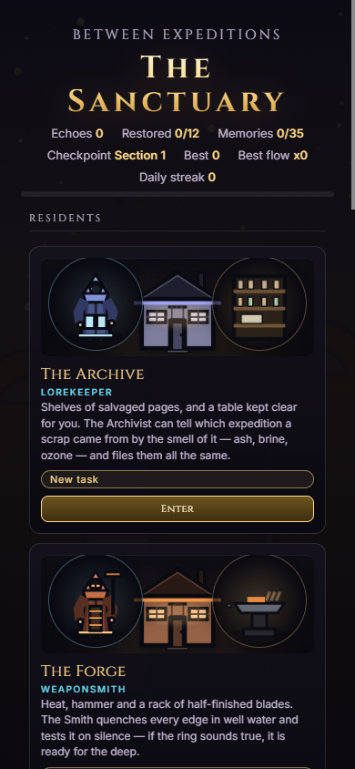
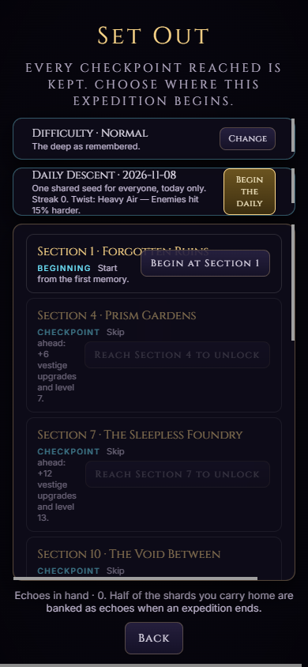
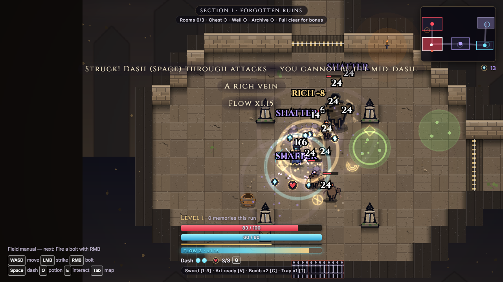

# Visual UI Review

Date: 2026-11-08

## Method

The running Vite build was driven through Edge headless over CDP in real time
(not virtual-time screenshots), at **1280x720** and **390x844** with mobile
metrics. The path was title → hub → Set Out → prologue → start room → a real
combat room; the combat capture used the `window.__MR__` debug handle to place
the walker in a combat room, then a real strike. Loading was captured separately
with the mobile viewport before the renderer finished.

Screenshots are stored under `docs/qa/cycle-ui-review-*.png`.

## Committed proof

The code changes and captures landed in **`2fcb82d`** (`feat(ui): responsive
visual review pass`) and were pushed at **`0d1c872`**. The commit contains:

| File | Change |
| --- | --- |
| `index.html` | `+3/-1`: loading-title clamp, wrap and width guards |
| `src/ui/ui.css` | `+165/-7`: toast panel, themed scrollbars, 390px layouts, wide feats wrap |
| `tests/ui-responsive-layout.test.ts` | `+55`: 3 regression tests for the responsive rules |
| `docs/qa/cycle-ui-review-*.png` | six post-fix captures |

The **after** images below were re-captured from the pushed HEAD (`0d1c872`),
not reused from the development pass. The **before** images are the original
pre-fix captures from the same CDP flow.

### Before / after: 390px hub

| Before | After |
| --- | --- |
|  |  |

### Before / after: 390px Set Out

| Before | After |
| --- | --- |
|  |  |

### Before / after: 1280x720 combat toast

| Before | After |
| --- | --- |
|  |  |

Additional final captures: `cycle-ui-review-final-gameplay-390.png`,
`cycle-ui-review-final-loading-390.png` and
`cycle-ui-review-final-hub-1280.png`.

## Findings and fixes

### 1. Raw browser scrollbars

**Seen:** hub feats strip, expedition checkpoint list and prologue story panel
used the browser's white/gray scrollbar against the dark UI.

**Fix:** `.screen` descendants now use a thin gold-on-dark scrollbar
(`scrollbar-width` plus `::-webkit-scrollbar` rules).

### 2. Narrow expedition layout

**Seen (390px):** the “Begin at Section 1” button collided with the checkpoint
title, the daily-descent button was clipped, and rows wrapped into narrow
columns.

**Fix (max-width 560px):** checkpoint rows are single-column with a full-width
start button; the daily panel puts its copy and button on separate full-width
rows; the checkpoint list is capped at `40vh` so the header, panels and Back
button fit.

### 3. Narrow hub buried Set Out

**Seen (390px):** each resident card was roughly 300px tall, so six residents
plus places pushed the expedition actions far below the fold.

**Fix (max-width 560px):** resident art is 72px, blurbs clamp to two lines and
cards are compact. The expedition panel is a fixed bottom bar with a dark
gradient and safe-area padding; disabled Continue/Rest buttons are hidden when
there is no saved run, leaving a single clear Set Out action.

### 4. Narrow HUD clipped the kit line

**Seen (390px):** the `Sword · Art · Bomb · Trap` line was cut off at the right
edge.

**Fix (max-width 560px):** the vitals column uses `calc(100vw - 24px)`, the HUD
row wraps, and the kit line becomes a full-width, wrapped, smaller line.

### 5. Narrow loading title clipped

**Seen (390px):** “RECONSTRUCTION” overflowed the loading screen.

**Fix:** the inline loading title uses `clamp(1.5rem, 7vw, 3rem)` with
`overflow-wrap: anywhere`; verified at the real 390px CDP viewport.

### 6. Wide 720p hub feats scrolled despite free space

**Seen (1280x720):** the feats strip was a one-row horizontal scroller with a
visible scrollbar, while the hub had a large empty lower area.

**Fix (min-width 1180px, max-height 820px):** the feats strip wraps into two rows
and no longer scrolls.

### 7. Combat tutorial toast obscured the arena

**Seen (combat):** the first-run “Struck! Dash…” tip was a full-width,
`white-space: nowrap` line over enemies and damage text, with little contrast.

**Fix:** toasts are bounded to `min(560px, 90vw)`, wrap, use a dark bordered
panel and sit at 16% from the top. Damage text and enemy models are no longer
competing with the tip.

## Models checked

The combat room was entered with `window.__MR__.world` and cleared through real
inputs. The capture showed these models:

| Model | Observation at 1280x720 / 390x844 |
| --- | --- |
| Player walker | Blue coat and scarf, visible blade; drop shadow stretches during dash. |
| Scavenger | Small tusked silhouette; purple body reads against the brown floor; HP bar visible. |
| Gutter runner | Low rat silhouette; distinct from the scavenger and memory echo. |
| Memory echo | Taller grey humanoid with a lunge windup; the red/green telegraph reads before contact. |
| Props | Crate, urn, brazier, waystone, checkpoint ring and memory crystals keep distinct silhouettes. |

`ActorView.makeShadow` already gives every actor a ground ellipse, so no sprite
or model edit was needed. The model-readability problem in the before capture
was the full-width tutorial toast covering the arena; bounding that toast
restored the models without changing the art.

## Verification

- **Code proof:** `git show --stat 2fcb82d` lists `index.html`,
  `src/ui/ui.css` (`+165/-7`) and the new 55-line test; `git diff 2fcb82d^
  2fcb82d -- index.html src/ui/ui.css tests/ui-responsive-layout.test.ts`
  contains the loading clamp, toast panel, scrollbar rules and three mobile
  media queries.
- **Capture proof:** 15 images under `docs/qa/cycle-ui-review-*.png`, including
  the before/after pairs above and the fresh final captures.
- **Runtime proof:** title, hub, Set Out, prologue, start room and a real combat
  room were reached through DOM clicks/keys at 1280x720 and 390x844; the final
  images show the fixed hub bar, stacked checkpoint rows, full HUD kit and
  bounded combat toast.
- `npm test`: 465 passed (84 files)
- `npm run test:mechanics`: 370 passed (55 files)
- typecheck, lint and build clean
- `python aikit.py check MemoryReconstruction`: 8/8
- `git rev-parse HEAD origin/main`: both `0d1c872`

## Remaining visual item

The short shrine/place screens (for example Meditation Stone) remain
top-aligned by the deliberate `safe center` rule that keeps tall shrine screens
on screen at 800x600. Centering short screens would require a separate
container-size rule and a fresh tall-screen check; it is left as a design
decision rather than changed in this pass.

## 2026-11-14 audit: geometry, contrast and focus

Method: the running Vite build was driven in Chromium at **390x844**, **768x1024** and **1440x900**.
Every screen reachable without combat (title, hub, Set Out, Settings, Controls, Notice Board, Training
Yard, Meditation Stone, Reliquary, Cairn, Aspect Shrine, Reforge, Memories) plus the in-run Pause, Map,
Relics and Quest screens was measured: every button was hit-tested with `elementFromPoint`, pairs of
visible buttons were checked for rect overlap, and panels/headings/buttons were checked for horizontal
overflow past the viewport. Elements clipped by a scroll container were excluded from the overlap
check, because their client rects extend outside the scrollport even though they cannot be clicked.

Results:

- No horizontal overflow and no clickable-button overlap on any of the 17 screens at the three widths.
- The Relics bag and the Quest log at 390x844 report their lower `Equip` / `Sell` / `Discard` / `Back`
  buttons below the fold. They sit inside the scrolling `.screen`, so scrolling reaches them; this is
  expected on a tall phone and not a defect.
- One Set Out overlap was a false positive: at `scrollTop 0` five of the nine checkpoint rows are
  scrolled out of the `.checkpoint-list` scrollport, and their rects still cross the daily panels below.
  `elementFromPoint` confirmed only the five visible rows are reachable.
- Text contrast: a DOM sweep compositing every text colour over its painted ancestors found one failure
  in the whole UI, the empty bag slot ("Empty slot" and its hint at 2.08:1). It now uses `--ink-dim`
  (10.29:1). All palette tokens clear AA on both the page and a composited panel; `--ink-dim` clears 7:1
  because it is used at 10-11px.
- Focus: every button, card and clickable gear row shows a 2px cyan ring; sliders and checkboxes had only
  Chromium's near-black UA ring and now share the cyan ring. Settings opens focus on the Master volume
  slider, and Tab then visits the sliders, difficulty buttons, four checkboxes and Back in order.

A second pass measured the three screens no menu path reaches directly, rendered through the real
builders with a synthetic `RunState`: the level-up choice screen, the death summary and the victory
screen, at all four sizes. All three were clean (no overlap, overflow or covered buttons). The choice
screen needs about 225px of scroll at 390x844 because three 210px cards plus the reroll row exceed the
viewport; widening the cards to 300px was tried and does not reduce their height, so the scroll is
intrinsic and was left alone. The death screen needs 33px of scroll at 844x390, once the stats panel and
three menu buttons are laid out.

### Runtime check

Probe hygiene matters: port 4173 was already held by an unrelated app, and an earlier version of this
check used `!document.querySelector('.hud')?.classList.contains('hidden')`, which evaluates to true on a
page with no HUD at all. That attempt reported "in run" for the wrong app and typed its test keys into
it, so its clean result was meaningless. The numbers below were taken on a fresh port after asserting
`document.title === 'Memory Reconstruction'` and a real HUD (present and not hidden).

A 20-second played session at 1280x800 (walking, swinging, dashing, stance swaps, flask) collected zero
`pageerror` events and zero console errors, and the HUD stayed on Section 1.

A 60-second session sampled DOM nodes and the JS heap: nodes held at 103-104 throughout, and the heap
oscillated between 25 MB and 50 MB as the collector ran with no monotonic climb. Six Pause to Resume and
six Map to Close cycles each opened the expected screen ("Paused", "Section 1 - Forgotten Ruins") and
left the node count at 103-104, so screen teardown does not leak nodes.

### Second pass: every screen, three widths

A wider sweep opened **11 hub screens** (Set Out, Settings, Controls, Memories, Notice Board, Training
Yard, Meditation Stone, Reliquary, Cairn, Aspect Shrine, Reforge) and **4 in-run screens** (Relics bag,
Pause, map, Quests) at **390x844, 600x900 and 768x1024**, scanning every visible element whose client
rect leaves the viewport after excluding anything clipped by a scroll container. The bag run injected a
rank-3 "Colossus Plate" and a second relic so long names were stressed.

Result: 48 of 48 scans clean, no horizontal overflow or scroll (`scrollWidth === clientWidth`).

Method notes, because the first attempt at this sweep produced a misleading "clean":

- The hub's station buttons are `<button class="btn station-button">` whose accessible name is the title
  followed by the description ("Notice BoardRead the tasks..."), so exact-name role lookup fails at every
  width. The first sweep silently recorded those seven screens as "NOT OPENED" while still reporting
  "clean" for the rest. The corrected sweep clicks by text prefix and asserts a screen with the expected
  heading actually opened, so a screen cannot be counted without being visited.
- At 390 the hub is a 2200px scroll of building cards and a two-column station grid (179px tiles), not a
  row of named buttons; the earlier desktop-only navigation never reached the stations at all.

The audit is ad hoc (no Playwright dependency in the project); it is recorded here so the method and the
clean baseline can be repeated after layout changes.

## 2026-11-15 review: headwear box and twenty-slot bag (agent reviewer: kilo:1)

The running Vite build was driven in Edge at **1280x720** and **390x844**. Slot 1 was loaded, the expedition
continued, and three head relics plus a worn Iron Helm were injected through the documented `window.__MR__.world`
handle before opening **I**. All five relic images (Iron Helm in the head box, Void Visor, Scout Hood and Oracle
Circlet in the bag, Rusted Edge in the weapon box) reported `complete` at 64 px. The phone layout measured a
278 px doll and a 334 px bag inside a 390 px viewport, `scrollWidth === clientWidth === 390`, and 24 boxes
(4 worn + 20 bag); "Carried 3/20" matched the bag. No console errors. The head box sits above the weapon box,
so the doll keeps its 128 px figure height and the panel still scrolls inside its 460 px cap.

Captures: `docs/qa/cycle95-headwear-1280x720.png`, `docs/qa/cycle95-headwear-390x844.png`.
