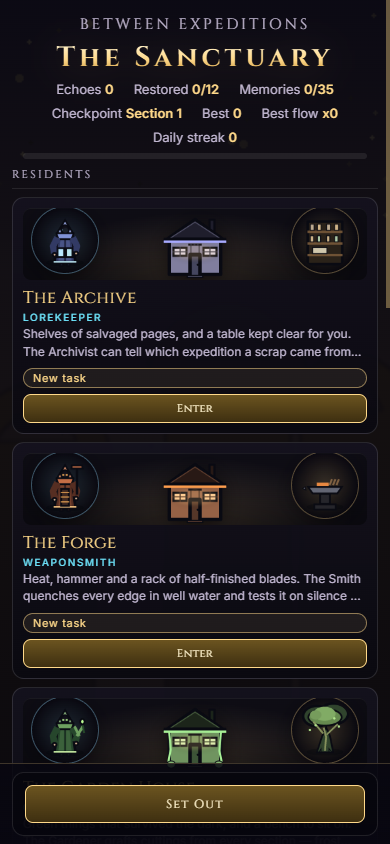
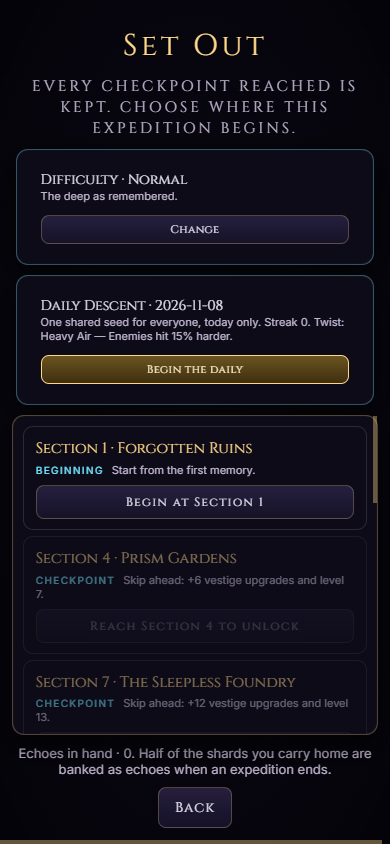
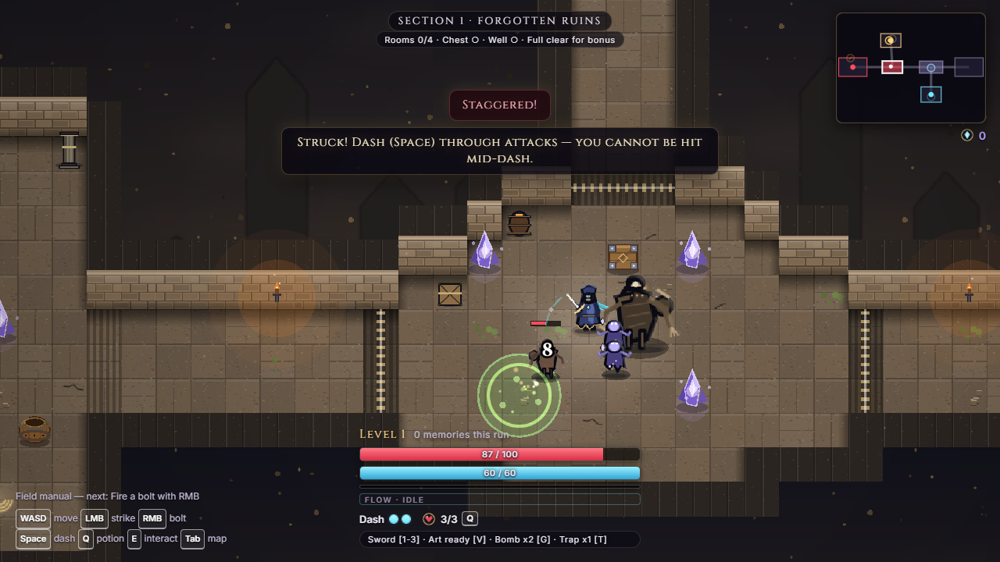

# Visual UI Review

Date: 2026-11-08

## Method

The running Vite build was driven through Edge headless over CDP in real time
(not virtual-time screenshots), at **1280x720** and **390x844** with mobile
metrics. The path was title → hub → Set Out → prologue → start room → a real
combat room; the combat capture used the `window.__MR__` debug handle to place
the walker in a combat room, then a real strike. Loading was captured separately
with the mobile viewport before the renderer finished.

Screenshots are stored under `docs/qa/cycle-ui-review-*.png`.

## Committed proof

The code changes and captures landed in **`2fcb82d`** (`feat(ui): responsive
visual review pass`) and were pushed at **`0d1c872`**. The commit contains:

| File | Change |
| --- | --- |
| `index.html` | `+3/-1`: loading-title clamp, wrap and width guards |
| `src/ui/ui.css` | `+165/-7`: toast panel, themed scrollbars, 390px layouts, wide feats wrap |
| `tests/ui-responsive-layout.test.ts` | `+55`: 3 regression tests for the responsive rules |
| `docs/qa/cycle-ui-review-*.png` | six post-fix captures |

The **after** images below were re-captured from the pushed HEAD (`0d1c872`),
not reused from the development pass. The **before** images are the original
pre-fix captures from the same CDP flow.

### Before / after: 390px hub

| Before | After |
| --- | --- |
|  |  |

### Before / after: 390px Set Out

| Before | After |
| --- | --- |
|  |  |

### Before / after: 1280x720 combat toast

| Before | After |
| --- | --- |
|  |  |

Additional final captures: `cycle-ui-review-final-gameplay-390.png`,
`cycle-ui-review-final-loading-390.png` and
`cycle-ui-review-final-hub-1280.png`.

## Findings and fixes

### 1. Raw browser scrollbars

**Seen:** hub feats strip, expedition checkpoint list and prologue story panel
used the browser's white/gray scrollbar against the dark UI.

**Fix:** `.screen` descendants now use a thin gold-on-dark scrollbar
(`scrollbar-width` plus `::-webkit-scrollbar` rules).

### 2. Narrow expedition layout

**Seen (390px):** the “Begin at Section 1” button collided with the checkpoint
title, the daily-descent button was clipped, and rows wrapped into narrow
columns.

**Fix (max-width 560px):** checkpoint rows are single-column with a full-width
start button; the daily panel puts its copy and button on separate full-width
rows; the checkpoint list is capped at `40vh` so the header, panels and Back
button fit.

### 3. Narrow hub buried Set Out

**Seen (390px):** each resident card was roughly 300px tall, so six residents
plus places pushed the expedition actions far below the fold.

**Fix (max-width 560px):** resident art is 72px, blurbs clamp to two lines and
cards are compact. The expedition panel is a fixed bottom bar with a dark
gradient and safe-area padding; disabled Continue/Rest buttons are hidden when
there is no saved run, leaving a single clear Set Out action.

### 4. Narrow HUD clipped the kit line

**Seen (390px):** the `Sword · Art · Bomb · Trap` line was cut off at the right
edge.

**Fix (max-width 560px):** the vitals column uses `calc(100vw - 24px)`, the HUD
row wraps, and the kit line becomes a full-width, wrapped, smaller line.

### 5. Narrow loading title clipped

**Seen (390px):** “RECONSTRUCTION” overflowed the loading screen.

**Fix:** the inline loading title uses `clamp(1.5rem, 7vw, 3rem)` with
`overflow-wrap: anywhere`; verified at the real 390px CDP viewport.

### 6. Wide 720p hub feats scrolled despite free space

**Seen (1280x720):** the feats strip was a one-row horizontal scroller with a
visible scrollbar, while the hub had a large empty lower area.

**Fix (min-width 1180px, max-height 820px):** the feats strip wraps into two rows
and no longer scrolls.

### 7. Combat tutorial toast obscured the arena

**Seen (combat):** the first-run “Struck! Dash…” tip was a full-width,
`white-space: nowrap` line over enemies and damage text, with little contrast.

**Fix:** toasts are bounded to `min(560px, 90vw)`, wrap, use a dark bordered
panel and sit at 16% from the top. Damage text and enemy models are no longer
competing with the tip.

## Models checked

The combat room was entered with `window.__MR__.world` and cleared through real
inputs. The capture showed these models:

| Model | Observation at 1280x720 / 390x844 |
| --- | --- |
| Player walker | Blue coat and scarf, visible blade; drop shadow stretches during dash. |
| Scavenger | Small tusked silhouette; purple body reads against the brown floor; HP bar visible. |
| Gutter runner | Low rat silhouette; distinct from the scavenger and memory echo. |
| Memory echo | Taller grey humanoid with a lunge windup; the red/green telegraph reads before contact. |
| Props | Crate, urn, brazier, waystone, checkpoint ring and memory crystals keep distinct silhouettes. |

`ActorView.makeShadow` already gives every actor a ground ellipse, so no sprite
or model edit was needed. The model-readability problem in the before capture
was the full-width tutorial toast covering the arena; bounding that toast
restored the models without changing the art.

## Verification

- **Code proof:** `git show --stat 2fcb82d` lists `index.html`,
  `src/ui/ui.css` (`+165/-7`) and the new 55-line test; `git diff 2fcb82d^
  2fcb82d -- index.html src/ui/ui.css tests/ui-responsive-layout.test.ts`
  contains the loading clamp, toast panel, scrollbar rules and three mobile
  media queries.
- **Capture proof:** 15 images under `docs/qa/cycle-ui-review-*.png`, including
  the before/after pairs above and the fresh final captures.
- **Runtime proof:** title, hub, Set Out, prologue, start room and a real combat
  room were reached through DOM clicks/keys at 1280x720 and 390x844; the final
  images show the fixed hub bar, stacked checkpoint rows, full HUD kit and
  bounded combat toast.
- `npm test`: 465 passed (84 files)
- `npm run test:mechanics`: 370 passed (55 files)
- typecheck, lint and build clean
- `python aikit.py check MemoryReconstruction`: 8/8
- `git rev-parse HEAD origin/main`: both `0d1c872`

## Remaining visual item

The short shrine/place screens (for example Meditation Stone) remain
top-aligned by the deliberate `safe center` rule that keeps tall shrine screens
on screen at 800x600. Centering short screens would require a separate
container-size rule and a fresh tall-screen check; it is left as a design
decision rather than changed in this pass.

## 2026-11-14 audit: geometry, contrast and focus

Method: the running Vite build was driven in Chromium at **390x844**, **768x1024** and **1440x900**.
Every screen reachable without combat (title, hub, Set Out, Settings, Controls, Notice Board, Training
Yard, Meditation Stone, Reliquary, Cairn, Aspect Shrine, Reforge, Memories) plus the in-run Pause, Map,
Relics and Quest screens was measured: every button was hit-tested with `elementFromPoint`, pairs of
visible buttons were checked for rect overlap, and panels/headings/buttons were checked for horizontal
overflow past the viewport. Elements clipped by a scroll container were excluded from the overlap
check, because their client rects extend outside the scrollport even though they cannot be clicked.

Results:

- No horizontal overflow and no clickable-button overlap on any of the 17 screens at the three widths.
- The Relics bag and the Quest log at 390x844 report their lower `Equip` / `Sell` / `Discard` / `Back`
  buttons below the fold. They sit inside the scrolling `.screen`, so scrolling reaches them; this is
  expected on a tall phone and not a defect.
- One Set Out overlap was a false positive: at `scrollTop 0` five of the nine checkpoint rows are
  scrolled out of the `.checkpoint-list` scrollport, and their rects still cross the daily panels below.
  `elementFromPoint` confirmed only the five visible rows are reachable.
- Text contrast: a DOM sweep compositing every text colour over its painted ancestors found one failure
  in the whole UI, the empty bag slot ("Empty slot" and its hint at 2.08:1). It now uses `--ink-dim`
  (10.29:1). All palette tokens clear AA on both the page and a composited panel; `--ink-dim` clears 7:1
  because it is used at 10-11px.
- Focus: every button, card and clickable gear row shows a 2px cyan ring; sliders and checkboxes had only
  Chromium's near-black UA ring and now share the cyan ring. Settings opens focus on the Master volume
  slider, and Tab then visits the sliders, difficulty buttons, four checkboxes and Back in order.

A second pass measured the three screens no menu path reaches directly, rendered through the real
builders with a synthetic `RunState`: the level-up choice screen, the death summary and the victory
screen, at all four sizes. All three were clean (no overlap, overflow or covered buttons). The choice
screen needs about 225px of scroll at 390x844 because three 210px cards plus the reroll row exceed the
viewport; widening the cards to 300px was tried and does not reduce their height, so the scroll is
intrinsic and was left alone. The death screen needs 33px of scroll at 844x390, once the stats panel and
three menu buttons are laid out.

### Runtime check

Probe hygiene matters: port 4173 was already held by an unrelated app, and an earlier version of this
check used `!document.querySelector('.hud')?.classList.contains('hidden')`, which evaluates to true on a
page with no HUD at all. That attempt reported "in run" for the wrong app and typed its test keys into
it, so its clean result was meaningless. The numbers below were taken on a fresh port after asserting
`document.title === 'Memory Reconstruction'` and a real HUD (present and not hidden).

A 20-second played session at 1280x800 (walking, swinging, dashing, stance swaps, flask) collected zero
`pageerror` events and zero console errors, and the HUD stayed on Section 1.

A 60-second session sampled DOM nodes and the JS heap: nodes held at 103-104 throughout, and the heap
oscillated between 25 MB and 50 MB as the collector ran with no monotonic climb. Six Pause to Resume and
six Map to Close cycles each opened the expected screen ("Paused", "Section 1 - Forgotten Ruins") and
left the node count at 103-104, so screen teardown does not leak nodes.

### Second pass: every screen, three widths

A wider sweep opened **11 hub screens** (Set Out, Settings, Controls, Memories, Notice Board, Training
Yard, Meditation Stone, Reliquary, Cairn, Aspect Shrine, Reforge) and **4 in-run screens** (Relics bag,
Pause, map, Quests) at **390x844, 600x900 and 768x1024**, scanning every visible element whose client
rect leaves the viewport after excluding anything clipped by a scroll container. The bag run injected a
rank-3 "Colossus Plate" and a second relic so long names were stressed.

Result: 48 of 48 scans clean, no horizontal overflow or scroll (`scrollWidth === clientWidth`).

Method notes, because the first attempt at this sweep produced a misleading "clean":

- The hub's station buttons are `<button class="btn station-button">` whose accessible name is the title
  followed by the description ("Notice BoardRead the tasks..."), so exact-name role lookup fails at every
  width. The first sweep silently recorded those seven screens as "NOT OPENED" while still reporting
  "clean" for the rest. The corrected sweep clicks by text prefix and asserts a screen with the expected
  heading actually opened, so a screen cannot be counted without being visited.
- At 390 the hub is a 2200px scroll of building cards and a two-column station grid (179px tiles), not a
  row of named buttons; the earlier desktop-only navigation never reached the stations at all.

The audit is ad hoc (no Playwright dependency in the project); it is recorded here so the method and the
clean baseline can be repeated after layout changes.

## 2026-11-15 review: headwear box and twenty-slot bag (agent reviewer: kilo:1)

The running Vite build was driven in Edge at **1280x720** and **390x844**. Slot 1 was loaded, the expedition
continued, and three head relics plus a worn Iron Helm were injected through the documented `window.__MR__.world`
handle before opening **I**. All five relic images (Iron Helm in the head box, Void Visor, Scout Hood and Oracle
Circlet in the bag, Rusted Edge in the weapon box) reported `complete` at 64 px. The phone layout measured a
278 px doll and a 334 px bag inside a 390 px viewport, `scrollWidth === clientWidth === 390`, and 24 boxes
(4 worn + 20 bag); "Carried 3/20" matched the bag. No console errors. The head box sits above the weapon box,
so the doll keeps its 128 px figure height and the panel still scrolls inside its 460 px cap.

Captures: `docs/qa/cycle95-headwear-1280x720.png`, `docs/qa/cycle95-headwear-390x844.png`.

## 2026-11-15 review: resident pages, hub copy, balloons and banking (agent reviewer: kilo:1)

The running Vite build was driven in Edge at **1280x720**, **390x844** and **844x390** (short landscape).
- **Hub copy**: all six `.building-blurb` nodes reported `clientHeight === scrollHeight` (none clamped) at
  both 1280x720 and 390x844; all six stayed visible at short landscape (`display: block`), where the old
  rule hid them. At 1280x720 the hub root scrolled to 762px but the expedition bar ended at 716.7px inside
  the 720px viewport. No horizontal overflow at any size (`scrollWidth === innerWidth`).
- **Balloon**: standing next to the Archivist, `.npc-balloon` had no `below` class, top 91.94px and bottom
  170px, while the Sanctuary title ended at 65px; the full greeting (140+ chars) was rendered with no
  ellipsis. The down arrow still points at the speaker.
- **Dialogue**: on the Smith page (trust 0), `.trust-line` used 104.36-120.36px and the tribute button
  126.36-155.36px: a 6px gap, no overlap. At 390px the same pair measured 87-103px and 111-140px (8px gap),
  the dialogue panel was 358.8px wide and the document stayed at 390px. `Ask about the road` starts hidden
  (display none) and toggles the full hint panel (display grid).
- **Relic request**: injecting the Choir Staff into the vault turned the Archivist's panel from "not in the
  vault yet" into a **Give Choir Staff** button. Giving it removed the relic, added 140 echoes
  (1424 -> 1564), stored `archivist` in `relicRequests` and showed "Delivered. The Sanctuary remembers."
- **Banking**: covered by the sim tests (`tests/sim/relic-banking.test.ts`); the death recap copy was
  reviewed in source because forcing a death through the UI would discard the working save.

Captures: `docs/qa/cycle96-dialogue-1280x720.png`, `docs/qa/cycle96-dialogue-390x844.png`,
`docs/qa/cycle96-hub-390x844.png`.

## 2026-11-15 review: hub request badges, bank readout, save-slot action (agent reviewer: kilo:1)

The running Vite build was driven in Edge at **1280x720** and **390x844**.
- **Hub badges**: at 1280x720 the Archivist card showed `[New task, Relic given]` and the other five showed
  `[New task, Wants (relic)]` inside a `.building-badges` row. Adding Bog Crown to the vault re-rendered the
  Gardener as **Give Bog Crown** with class `quest-badge ready`. At 390x844 the badge row measured 344px in a
  366px card, stayed on one line, and the document had no horizontal overflow (scrollWidth 390).
- **Bank readout**: continuing the saved expedition showed "Checkpoint bank · 1 relic kept · everything
  carried is safe." in the Relics screen; injecting Void Visor and Sun Core and reopening the bag changed it
  to "1 relic kept · 2 new relics at risk until the next checkpoint" with `Carried · 2/20` and 24 boxes.
  The injected relics were removed before leaving, so the saved run was not polluted.
- **Save-slot action**: covered by `tests/ui-save-slot-action.test.ts` (active empty reads **Active slot**,
  active with progress reads **Playing**, non-active reads **Start here** or **Play**); the screen was not
  re-driven because switching slots would touch the working save.
No console errors were observed.

Captures: `docs/qa/cycle97-hub-badges-1280x720.png`, `docs/qa/cycle97-hub-badges-390x844.png`.

## 2026-11-15 review: capes, taller relic panel, quest log, maze stall and mana (agent reviewer: kilo:1)

The running Vite build was driven in Edge at **1280x720**, **768x1024** and **390x844**.
- **Relics and cape**: 25 boxes (5 worn + 20 bag) at every size; the doll measured 278x212 with head and cape boxes,
  and the Ember Drape/Void Mantle box read its title while `.doll-figure` carried a recoloured `data:image/png`
  background. The panel measured 481px under a 532.8px cap at 1280x720, 600px at 768x1024 and 571px at 390x844;
  the bag was 334px wide ending at 374.6px in the 390px viewport, so there was no horizontal overflow. The bank line
  read "1 relic kept - 3 new relics at risk until the next checkpoint".
- **Quest Log**: header counts read 0 active / 0 ready / 0 completed / 6 available; All/Active/Ready/Available/
  Completed tabs filtered the four sections (Active hid ready, available and done while keeping the daily mark);
  six portrait cards showed progress bars at 25%, 59%, 100% and 67%; at 390x844 a card was 358px inside 390 with no
  horizontal overflow and the journal scrolled 1573px inside 844px.
- **Maze stall**: five lines (healing 24, mana 30, bombs 40, traps 40, relic 110) at section 1; buying the Mana
  draught took shards 500 -> 470, raised flasks 1 -> 2 and flipped that line to a disabled "Sold" button. The HUD
  prompt now reads "Browse the merchant's wares".
- **Mana flask**: pressing R at 0 mana restored 60/60 and took flasks 2 -> 1; the HUD chip showed "1 R".
- **Level-up guard**: a forced level card appeared 17ms after the pending choice; clicking it immediately left the
  choice pending with no upgrade taken; clicking after 1.6s took `vitality` and resumed play. Double-clicks are
  rejected by `deliberateClick` and covered by unit tests.
- **Levels**: the curve and kill-XP changes are covered by the sim tests (42/1.6, 0.3 scale); no browser run was
  needed to trust the arithmetic.
No console errors were observed. Captures: `docs/qa/cycle98-cape-inventory-1280x720.png`,
`cycle98-cape-inventory-390x844.png`, `cycle98-quest-log-1280x720.png`, `cycle98-quest-log-390x844.png`,
`cycle98-merchant-shop-1280x720.png`.

## 2026-11-16 review: guaranteed wandering merchant and Flasks full (agent reviewer: kilo:1)

The running Vite build was driven on a fresh server (port 3001) at **1280x720** to avoid a stale HMR module.
- **Guaranteed stall**: Section 1 of a new run listed one merchant with label **Wandering merchant**; the run had
  started without any vault roll, so this is the fallback stall from ADR-225.
- **Full flasks**: standing beside the stall with potions 3/3 and 0 shards, the healing line read **Flasks full** and
  was disabled, while the mana, bomb, trap and relic lines kept their price labels and were disabled by the empty
  purse. This is the exact case that previously read "24 shards" and clicked for no effect.
- **Cape pixels**: covered by four new `gear-look` unit tests rather than the browser (cyan moves, robe/skin/gold
  untouched, robe+cape compose, alpha preserved); the visual cape recolour was already captured in Cycle 98.
No console errors were observed. Capture: `docs/qa/cycle99-flasks-full-1280x720.png`.

## 2026-11-16 review: quest chapters, tracker, and the Gilded Reliquary (agent reviewer: kilo:1)

The running Vite build was driven in Edge at **1280x720** and **390x844** on a fresh server.
- **Quest log**: 13 cards (12 chapters plus the daily mark), subtitle "0 active · 0 ready · 0 completed · 12
  available", a Track button on every open chapter. Tracking **Names in the Index** saved
  `meta.trackedQuest = names`, added the `tracked` border and changed the button to **Untrack**.
- **HUD tracker**: after starting Section 1, `.hud-tracker` was visible at top 104 with "Tracking · Names in
  the Index · 0/4"; it is hidden when nothing is tracked or after the chapter is claimed.
- **New section**: with the checkpoint temporarily raised to 21, **Section 22 · The Gilded Reliquary** became
  selectable; the run loaded at depth 21 with the plan's roster (rivet_squire, solder_wisp, cog_hound,
  bone_picker, cinder_stalker, spire_marksman), boss `reliquary_warden`, and the matching floor line. The
  Salt Orchard is covered by the plan/data tests because it is not a checkpoint start point.
- **Phone**: at 390x844 the journal kept 13 cards, a 358.8px card ending at 374.4px, a 59.7px Track button and
  no horizontal overflow (scrollWidth 390).
- **Console**: the fresh server reported 0 errors. An earlier dev server died mid-session and produced an
  ERR_CONNECTION_REFUSED storm in the old tab; that was infrastructure, not game code. No game console errors
  were observed before or after it.

Captures: `docs/qa/cycle100-quest-log-tracked-1280x720.png`, `cycle100-hud-tracker-1280x720.png`,
`cycle100-gilded-reliquary-1280x720.png`, `cycle100-quest-log-390x844.png`.
