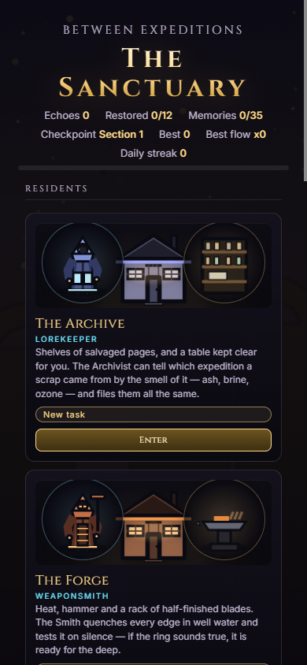
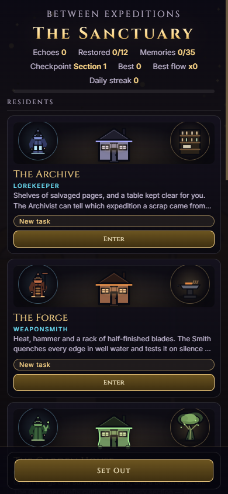
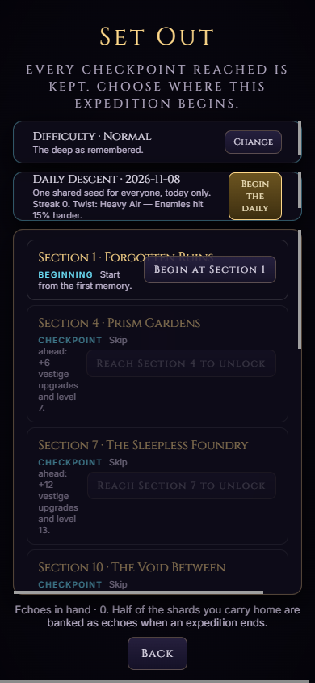
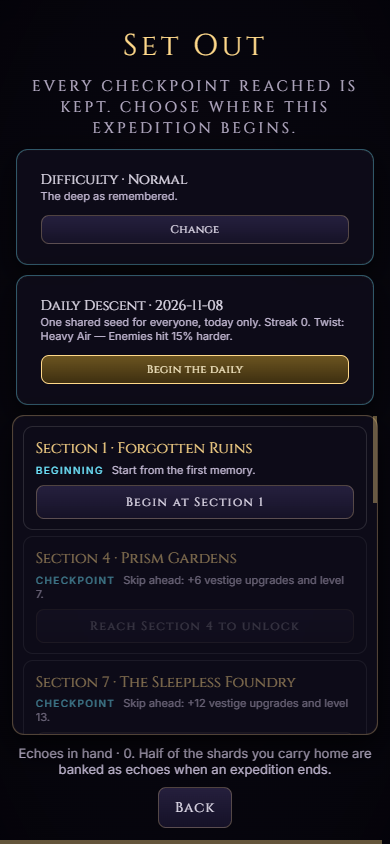
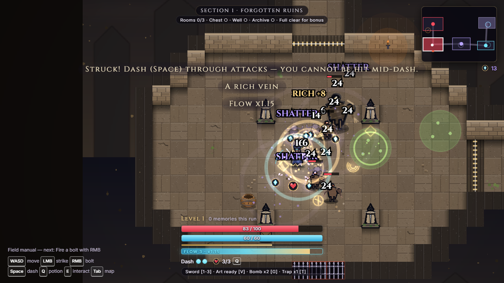
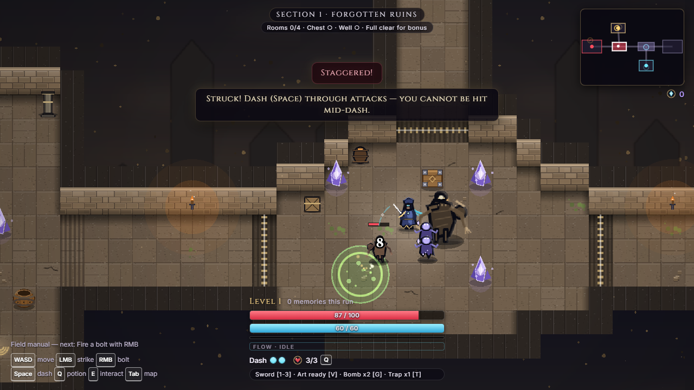

# Visual UI Review

Date: 2026-11-08

## Method

The running Vite build was driven through Edge headless over CDP in real time
(not virtual-time screenshots), at **1280x720** and **390x844** with mobile
metrics. The path was title → hub → Set Out → prologue → start room → a real
combat room; the combat capture used the `window.__MR__` debug handle to place
the walker in a combat room, then a real strike. Loading was captured separately
with the mobile viewport before the renderer finished.

Screenshots are stored under `docs/qa/cycle-ui-review-*.png`.

## Committed proof

The code changes and captures landed in **`2fcb82d`** (`feat(ui): responsive
visual review pass`) and were pushed at **`0d1c872`**. The commit contains:

| File | Change |
| --- | --- |
| `index.html` | `+3/-1`: loading-title clamp, wrap and width guards |
| `src/ui/ui.css` | `+165/-7`: toast panel, themed scrollbars, 390px layouts, wide feats wrap |
| `tests/ui-responsive-layout.test.ts` | `+55`: 3 regression tests for the responsive rules |
| `docs/qa/cycle-ui-review-*.png` | six post-fix captures |

The **after** images below were re-captured from the pushed HEAD (`0d1c872`),
not reused from the development pass. The **before** images are the original
pre-fix captures from the same CDP flow.

### Before / after: 390px hub

| Before | After |
| --- | --- |
|  |  |

### Before / after: 390px Set Out

| Before | After |
| --- | --- |
|  |  |

### Before / after: 1280x720 combat toast

| Before | After |
| --- | --- |
|  |  |

Additional final captures: `cycle-ui-review-final-gameplay-390.png`,
`cycle-ui-review-final-loading-390.png` and
`cycle-ui-review-final-hub-1280.png`.

## Findings and fixes

### 1. Raw browser scrollbars

**Seen:** hub feats strip, expedition checkpoint list and prologue story panel
used the browser's white/gray scrollbar against the dark UI.

**Fix:** `.screen` descendants now use a thin gold-on-dark scrollbar
(`scrollbar-width` plus `::-webkit-scrollbar` rules).

### 2. Narrow expedition layout

**Seen (390px):** the “Begin at Section 1” button collided with the checkpoint
title, the daily-descent button was clipped, and rows wrapped into narrow
columns.

**Fix (max-width 560px):** checkpoint rows are single-column with a full-width
start button; the daily panel puts its copy and button on separate full-width
rows; the checkpoint list is capped at `40vh` so the header, panels and Back
button fit.

### 3. Narrow hub buried Set Out

**Seen (390px):** each resident card was roughly 300px tall, so six residents
plus places pushed the expedition actions far below the fold.

**Fix (max-width 560px):** resident art is 72px, blurbs clamp to two lines and
cards are compact. The expedition panel is a fixed bottom bar with a dark
gradient and safe-area padding; disabled Continue/Rest buttons are hidden when
there is no saved run, leaving a single clear Set Out action.

### 4. Narrow HUD clipped the kit line

**Seen (390px):** the `Sword · Art · Bomb · Trap` line was cut off at the right
edge.

**Fix (max-width 560px):** the vitals column uses `calc(100vw - 24px)`, the HUD
row wraps, and the kit line becomes a full-width, wrapped, smaller line.

### 5. Narrow loading title clipped

**Seen (390px):** “RECONSTRUCTION” overflowed the loading screen.

**Fix:** the inline loading title uses `clamp(1.5rem, 7vw, 3rem)` with
`overflow-wrap: anywhere`; verified at the real 390px CDP viewport.

### 6. Wide 720p hub feats scrolled despite free space

**Seen (1280x720):** the feats strip was a one-row horizontal scroller with a
visible scrollbar, while the hub had a large empty lower area.

**Fix (min-width 1180px, max-height 820px):** the feats strip wraps into two rows
and no longer scrolls.

### 7. Combat tutorial toast obscured the arena

**Seen (combat):** the first-run “Struck! Dash…” tip was a full-width,
`white-space: nowrap` line over enemies and damage text, with little contrast.

**Fix:** toasts are bounded to `min(560px, 90vw)`, wrap, use a dark bordered
panel and sit at 16% from the top. Damage text and enemy models are no longer
competing with the tip.

## Models checked

The combat room was entered with `window.__MR__.world` and cleared through real
inputs. The capture showed these models:

| Model | Observation at 1280x720 / 390x844 |
| --- | --- |
| Player walker | Blue coat and scarf, visible blade; drop shadow stretches during dash. |
| Scavenger | Small tusked silhouette; purple body reads against the brown floor; HP bar visible. |
| Gutter runner | Low rat silhouette; distinct from the scavenger and memory echo. |
| Memory echo | Taller grey humanoid with a lunge windup; the red/green telegraph reads before contact. |
| Props | Crate, urn, brazier, waystone, checkpoint ring and memory crystals keep distinct silhouettes. |

`ActorView.makeShadow` already gives every actor a ground ellipse, so no sprite
or model edit was needed. The model-readability problem in the before capture
was the full-width tutorial toast covering the arena; bounding that toast
restored the models without changing the art.

## Verification

- **Code proof:** `git show --stat 2fcb82d` lists `index.html`,
  `src/ui/ui.css` (`+165/-7`) and the new 55-line test; `git diff 2fcb82d^
  2fcb82d -- index.html src/ui/ui.css tests/ui-responsive-layout.test.ts`
  contains the loading clamp, toast panel, scrollbar rules and three mobile
  media queries.
- **Capture proof:** 15 images under `docs/qa/cycle-ui-review-*.png`, including
  the before/after pairs above and the fresh final captures.
- **Runtime proof:** title, hub, Set Out, prologue, start room and a real combat
  room were reached through DOM clicks/keys at 1280x720 and 390x844; the final
  images show the fixed hub bar, stacked checkpoint rows, full HUD kit and
  bounded combat toast.
- `npm test`: 465 passed (84 files)
- `npm run test:mechanics`: 370 passed (55 files)
- typecheck, lint and build clean
- `python aikit.py check MemoryReconstruction`: 8/8
- `git rev-parse HEAD origin/main`: both `0d1c872`

## Remaining visual item

The short shrine/place screens (for example Meditation Stone) remain
top-aligned by the deliberate `safe center` rule that keeps tall shrine screens
on screen at 800x600. Centering short screens would require a separate
container-size rule and a fresh tall-screen check; it is left as a design
decision rather than changed in this pass.
